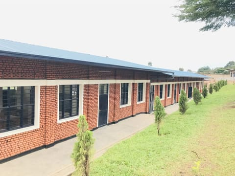

# ECOSG Company Ltd — Website Handover

Everything needed to pick this project up cold and keep building.

**Repo:** https://github.com/Thierry-stack/ecosge-web
**Last commit at time of writing:** `938590c`
**Stack:** static HTML + CSS + vanilla JS. No framework, no build step, no dependencies.

---

## 1. The client

| | |
|---|---|
| Name | ECOSG Company Ltd |
| Type | Category B construction company, RDB-registered |
| Company code | 105342010 |
| Founded | 12 February 2016 |
| Address | Niboye, Kicukiro, Kigali, Rwanda — P.O. Box 6696 |
| Phone | +250 788 236 670 |
| Email | ecosgcompanyltd@gmail.com |
| WhatsApp | wa.me/250788236670 |
| Slogan | "Until it's done" |

Work covers buildings, roads, bridges, health facilities, water and sanitation, and public infrastructure for districts, national institutions and private clients.

---

## 2. Hard constraints

These shaped every decision. Breaking one of them means rewriting a lot.

1. **Static HTML/CSS/JS, no framework dependency, hostable anywhere.** This is load-bearing. Mid-project a React/shadcn/Tailwind component spec was supplied for the rotating gallery; it was reimplemented in vanilla CSS 3D + JS instead of migrating the stack, because migrating would have broken this constraint.
2. **No build step.** Open `index.html` in a browser and it works. There is no bundler, no `package.json`, no `node_modules` in the repo.
3. **Palette is yellow, black and green only.**
4. **Mobile-first and fully responsive.**
5. **Animations subtle, no gimmicks.** `prefers-reduced-motion` is respected throughout.
6. **Real project photos, never placeholders.**
7. Reference sites for tone and structure: `fdgafrica.com` and `real.rw`.

---

## 3. Running it

```bash
node tools/serve.js 5173
```

Then open http://localhost:5173

`tools/serve.js` is a ~60-line zero-dependency static server. It exists only for local preview — it is **not** needed to deploy. Two things it does deliberately:

- Sends `Cache-Control: no-store` on everything, so you never debug a stale file.
- Falls back `/services` → `/services.html`, matching how most static hosts behave.

In Claude Code, `.claude/launch.json` defines this as the `ecosg-site` preview config.

---

## 4. Deploying

Any static host works — GitHub Pages, Netlify, Cloudflare Pages, Hostinger, plain shared hosting. Upload the repo contents; there is nothing to compile.

**Before going live:**

- `sitemap.xml` currently hardcodes `https://www.ecosgcompanyltd.rw/`. If the real domain differs, update all five `<loc>` entries.
- `robots.txt` references `sitemap.xml` relatively. Most crawlers want an absolute URL here.
- Make sure the host serves gzip or brotli. The dev server does not compress, so local numbers look worse than production will be. CSS and HTML compress to roughly a fifth of their size.
- `tools/serve.js` can be deleted from a deployment; it is a dev helper only.

---

## 5. File map

```
index.html          Home — hero + rotating gallery, ticker, stats, about teaser,
                    services teaser, featured spotlight, trusted strip, CTA
about.html          Story, mission/vision, leadership, credentials
services.html       8 service cards + 5-step process timeline
projects.html       12 project cards, filterable, with grouped lightbox
contact.html        Form, WhatsApp, map, contact details

css/style.css       892 lines. The entire design system. Single file by design.
js/main.js          362 lines. One IIFE, 12 labelled sections. No dependencies.
tools/serve.js      Dev-only static server.

assets/img/         56 files: 16 base photos + 36 sized variants + logo + 3 favicons
.claude/launch.json Preview config for Claude Code
sitemap.xml         5 URLs
robots.txt          Allow all
.gitignore          Excludes raw source material (see Privacy below)
```

---

## 6. Design system

Everything lives in `:root` at the top of `css/style.css`. Change a colour there and the whole site follows.

### ⚠️ The token names lie

The palette was rebuilt from a blue/navy/red scheme to yellow/black/green, but **the variable names were never renamed**:

| Variable prefix | Name suggests | Actually is |
|---|---|---|
| `--navy-*` | navy blue | **black** (`#050505` → `#4a4a4a`) |
| `--sky-*` | sky blue | **green** (`#157a3d` → `#f1fbf4`) |
| `--red-*` | red | **yellow** (`#e6ac00` → `#fff3d1`) |

This is the single most confusing thing in the codebase. Renaming them is a safe mechanical find-and-replace across `css/style.css` only (no HTML references them) and is worth doing early if you expect anyone else to touch this.

Semantic aliases already sit on top and are safe to use directly:

```css
--color-primary    /* black  */
--color-accent     /* yellow */
--color-secondary  /* green  */
--color-text, --color-text-soft, --color-bg, --color-bg-alt, --color-border
```

### Other tokens

- **Type:** `--font-head` Poppins, `--font-body` Inter. Loaded from Google Fonts with `display=swap` and `preconnect` hints.
- **Layout:** `--container-w: 1240px`, `--container-pad: 1.25rem`.
- **Radii:** `--radius-sm/md/lg/pill`.
- **Motion:** `--ease: cubic-bezier(.22,.61,.36,1)`, `--dur-fast/med/slow`.
- **Shadows:** `--shadow-sm/md/lg/navy/red`.

### CSS section map

The file is organised in labelled bands — `grep '^/\* ====' css/style.css` lists them. Order matters (see §9).

---

## 7. JavaScript

`js/main.js` is one IIFE with twelve labelled sections. Every feature degrades gracefully if its DOM hooks are absent, so the same file ships on all five pages.

| Section | What it does |
|---|---|
| Footer year | Writes the current year |
| Header scroll state | Solid-on-scroll, inner-page variant |
| Mobile nav toggle | Opens the drawer + scrim, traps nothing (simple by design) |
| Active nav link | Marks the current page |
| Back to top | Smooth scroll, respects reduced motion |
| Card carousels | Auto-swipes images inside project cards |
| Circular 3D gallery | The rotating hero ring — auto-rotate + pointer drag |
| Scroll reveal | IntersectionObserver, unobserves after firing |
| Stat counters | Counts up when the stats card enters view |
| Project filter | Filters the 12 cards by category |
| Lightbox | Grouped via `data-group`, full-size via `data-full` |
| Contact form | **mailto only — no backend** |

### The contact form has no backend

It builds a `mailto:` URL and sets `window.location.href`. The user's mail client opens with the message pre-filled; they still have to press send. The on-page status message says so, and points at WhatsApp as the faster route.

If you want real submissions, swap in Formspree, Netlify Forms, Web3Forms or a small serverless endpoint. The handler is the last ~35 lines of `main.js` and is self-contained.

### Both animation loops pause when off-screen

This was a deliberate performance fix. The gallery's `requestAnimationFrame` loop and all twelve carousel `setInterval` timers stop when their element leaves the viewport (IntersectionObserver) **and** when the tab is hidden (`visibilitychange`). If you add another looping animation, do the same — the ring alone was writing 21 inline styles per frame on an 8,000px-tall page, forever.

---

## 8. The image pipeline

This is the least obvious part of the project and the easiest to break.

### Three tiers plus the original

| File | Width | Used by |
|---|---|---|
| `name.jpg` | ≤1200px | Lightbox (`data-full`), page-banner CSS backgrounds |
| `name-1000.jpg` | 1000px | Card carousels, split-media blocks |
| `name-720.jpg` | 720px | Hero ring on retina screens |
| `name-480.jpg` | 480px | Hero ring on 1x screens, hidden lightbox-only thumbs |

Not every base has every tier — a tier is only generated if something references it, and never upscaled. Current coverage:

```
full 480 720 1000  kigoma-01, kigoma-02, kigoma-05, kigoma-06, kigoma-07,
                   nyabisindu-02, nyabisindu-03, nyabisindu-08
full 480 1000      kigoma-03, nyabisindu-04
full 480 720       nyabisindu-06, nyabisindu-07
full 480           kigoma-04, kigoma-08, nyabisindu-01, nyabisindu-05
```

### Why 1200px is the ceiling

The lightbox is capped by CSS at `max-width: min(1100px, 92vw)` and `max-height: 76vh`. Nothing on the site can ever display an image wider than ~1100px, so storing anything above 1200px is bytes nobody can see.

### The hero ring uses srcset

```html

```

The `sizes` values are the **rendered** card widths, which include the 3D perspective scale — a 237px card at radius 600 / perspective 1900 draws at ~346px. If you change the ring's radius, card width or perspective, recompute `sizes` or the browser will pick the wrong file.

### Adding new photos

1. Drop the full-size photo in `assets/img/`, long edge ≤1200px, JPEG quality ~80 progressive.
2. Generate whichever tiers the contexts you're using need.
3. Reference the right tier for the context — never the full file in a card.
4. Put the **full** path in `data-full` so the lightbox still gets the big one.
5. Add `width` and `height` attributes matching the file you referenced.
6. Name descriptively: `location-NN-what-it-shows.jpg`.

There is no script in the repo for step 2 — variants were generated ad hoc with `sharp`. **Worth adding `tools/images.js` as the next task** so this is reproducible. One Windows gotcha if you write it: `sharp` keeps the source file handle open, so `fs.readFileSync` into a buffer first if you want to overwrite a file in place, or the write fails with `UNKNOWN`.

### Every `` declares width and height

48 of them, all verified against the files on disk. This reserves the box so photos don't shift the layout as they load. Keep it up when adding images.

### Cache busting

CSS and JS are referenced as `style.css?v=20260919`. Bump the date on all five pages when you ship a change to either file.

---

## 9. Things that will bite you

Real bugs hit during this build, with the fix. Read this section before debugging anything odd.

### CSS equal-specificity ordering — hit three separate times

`.circular-gallery--hero` and `.circular-gallery` are both single-class selectors. Same specificity, so **source order decides**. The modifier was declared before the base and was silently ignored.

Same trap caught `.hero-scroll` inside a `max-width: 1023px` block, and `.card-carousel` against `.gallery-item img`.

**Rule: modifiers and breakpoint overrides go after the base rule they override.** The fix each time was moving the rule, never adding `!important`. There are comments in the CSS at each of these spots saying so — don't "tidy" them by reordering.

### A `*/` inside a CSS comment silently deleted the entire palette

A comment reading `--navy-*/--sky-*` closed early at the `*/`, which broke the whole `:root` block. Every custom property returned `""` and buttons lost their backgrounds. **Never write `*/` inside a CSS comment** — that's why the current comments say `"navy" tokens -> black scale` instead of using asterisks.

### `backdrop-filter` creates a containing block for `position: fixed`

`.site-header` had `backdrop-filter: blur()`, which made it the containing block for fixed-position descendants and broke the mobile nav. Removed entirely. Don't add it back without checking the drawer.

### The mobile menu's z-index stack

`.site-header: 90`, `.nav-scrim: 95`, `.main-nav: 96`. The menu was once invisible because `.main-nav` had no `z-index` and sat under the scrim. Computed-style checks did not catch this — it only showed in a screenshot, because the bug was in relative paint order, not in any single property's value.

### The hero's stacking contexts

`.hero-content` has `position: relative; z-index: 2`, which makes it a stacking context. The rotating gallery **cannot** be nested inside it — at desktop widths it would paint above the scrim and above the text.

The working structure keeps the gallery as a direct child of `.hero`, with the copy split into two sibling containers:

```html
<section class="hero">
  <div class="container hero-content">        <!-- badge, h1, lead -->
  <div class="circular-gallery--hero">        <!-- the ring -->
  <div class="container hero-content hero-content--actions">  <!-- buttons, stats -->
  <div class="hero-scroll">
</section>
```

`.hero` is a **column** flex with `justify-content: center`, so the two copy containers stack instead of lining up side by side. Below 1024px flex `order` interleaves them (1 / 2 / 3); from 1024px up the gallery goes `position: absolute; inset: 0` and becomes a full-bleed backdrop behind the scrim.

The banner's 9rem/5rem vertical padding is **split across the two containers** so the rhythm isn't doubled.

### Hero ring geometry per breakpoint

| Breakpoint | radius | card | band height | perspective | layout |
|---|---|---|---|---|---|
| `<640px` | 280 | 150×200 | 262px | 1400 | in-flow band |
| `≥640px` | 330 | 157×210 | 330px | 1700 | in-flow band |
| `≥1024px` | 480 | 213×287 | 100% | 1900 | **absolute backdrop** |
| `≥1440px` | 600 | 237×317 | 100% | 1900 | absolute backdrop |

The phone band height is sized to exactly clear the front card once perspective scales it: `200 × 1400/(1400−280) = 250px`, band 262px. Change the radius or perspective and that arithmetic has to be redone, or the scaled card overflows into the paragraph above.

### Never give the stats card a negative top margin

`.stats-band` once had `margin-top: -4.5rem` from when it sat directly after the hero. The yellow ticker was inserted between them later, and since the ticker paints at `z-index: 4` against the card's `3`, the band covered the top 72px of the card — cutting every stat number in half. It now uses a positive `3rem` gap (`2rem` on phones).

### `loading="lazy"` does nothing above the fold

All ten hero gallery images carry `loading="lazy"` but every one downloads immediately, because they're all in the first viewport. Lazy loading is not a substitute for serving a correctly-sized file.

---

## 10. Known issues / not done

| | |
|---|---|
| **Poppins 500 is requested but never loaded** | `.main-nav a` asks for `font-weight: 500`, but the Google Fonts URL only loads Poppins 600 and 700. The nav has always rendered at 600. Decide deliberately: add `500` to the font URL, or change the rule to 600. |
| **No image-variant script** | Variants were generated ad hoc. See §8 — adding `tools/images.js` is the highest-value next task. |
| **Contact form is mailto-only** | §7. No submissions are recorded anywhere. |
| **`sitemap.xml` domain may be wrong** | Hardcoded to `www.ecosgcompanyltd.rw`. |
| **Stats say 9 districts, hero says 4 provinces** | Both are hand-written; confirm against real records before launch. |
| **No favicon.ico** | Only PNG favicons (32/180/512). Some older crawlers want `/favicon.ico`. |
| **No 404 page** | Static hosts will show their own. |
| **Dead CSS not audited** | An automated scan was attempted and produced false positives (it flagged `btn` and `split-media`, both obviously used). The file is 892 lines and compresses to roughly a fifth of that, so this is low value — but it was never properly done. |
| **Git credential helper is stale** | `git push` prints `git: 'credential-manager-core' is not a git command`. The push succeeds via another helper, but the warning persists until the config is updated. |

---

## 11. Privacy

`.gitignore` deliberately excludes source material that must not be published:

- `images/` — raw originals, including photos with third-party client contact details visible
- `ok RDB CERTIFICATE.pdf` — **contains the Managing Director's National ID number**
- `COMPANY LOGO ECOSG.pdf`, `ecosg_logo_square_full.png` — oversized duplicates

Client phone numbers and email addresses from the source documents were deliberately kept off both the live site and the repo. Keep it that way — only the company's own public contact details appear on the site.

---

## 12. Performance baseline

A full optimisation pass was done in commit `938590c`. Current numbers, measured in-browser:

| | Before | After |
|---|---|---|
| Home page, phone @ DPR 2 | 1636 KB | **524 KB** |
| Hero ring images | 1551 KB | 265 KB (480 tier) / 582 KB (720 tier) |
| Logo, on every page | 365 KB | 25 KB |
| Projects page, initial load | — | 138 KB |

What was wrong: every photo shipped at full size regardless of how small it was drawn. The hero ring alone fetched ten 1400px photos — 1551 KB — for cards at most 346px wide. The logo was 365 KB for something drawn 42px tall in the header of all five pages.

If you add photos, re-measure. The easiest regression to introduce here is referencing a full-size file from a card.

---

## 13. Commit history

Readable narrative of how this got built:

```
7886f24  Initial commit: ECOSG Company Ltd website
f940427  Add auto-swiping photo carousels; unify project cards
5564a87  Add 3D circular project gallery to homepage
214f7d5  Disable caching on the local dev server
c0ffa03  Version CSS/JS URLs to defeat browser caching
d77e9a1  Move the rotating gallery into the hero banner
8977e99  Scale hero gallery cards to two-thirds
5c55a3b  Shorten hero headline and reduce hero type sizes
a0d5a3d  Stack the hero on phones and tablets
43822e8  Move the hero gallery between the paragraph and the CTAs
752856a  Enlarge the hero cards and drop the desktop backdrop layout
fac192d  Enlarge the phone hero cards and tuck them under the paragraph
f9f494a  Stop the ticker from cutting the stats numbers in half
938590c  Cut the home page from 1.6 MB to 524 KB
```

Commit messages are written to explain *why*, not just what. Several of them record the reasoning behind a non-obvious fix — worth reading `git log` before changing the hero or the image pipeline.

---

## 14. Suggested next steps

1. **Rename the palette tokens** (`--navy-*` → `--black-*`, `--sky-*` → `--green-*`, `--red-*` → `--yellow-*`). Mechanical, CSS-only, removes the biggest source of confusion.
2. **Add `tools/images.js`** so variant generation is reproducible instead of ad hoc.
3. **Decide the Poppins 500 question** — load the weight or change the rule.
4. **Give the contact form a real backend** if enquiries matter.
5. **Confirm the live domain** and fix `sitemap.xml` and `robots.txt`.
6. **Verify the stat numbers** against real company records.
